<div align="center">

  <!-- Animated Hero Banner -->
  <a href="https://github.com/tachyon-ops">
    
  </a>

  <!-- Animated Typing Subtitle -->
  <a href="https://github.com/tachyon-ops">
    
  </a>

  <p>
    <a href="https://library-of-alexandria-ruby.vercel.app" target="_blank">
      
    </a>
    <a href="https://nuuno.art" target="_blank">
      
    </a>
    <a href="https://drrtechradar.org/" target="_blank">
      
    </a>
    <a href="https://github.com/sponsors/tachyon-ops" target="_blank">
      
    </a>
    <a href="https://www.paypal.com/donate/?cmd=_s-xclick&hosted_button_id=D3J2WXTXLAWK8&source=url&ssrt=1792150968588" target="_blank">
      
    </a>
    <a href="https://calendly.com/ribeiron" target="_blank">
      
    </a>
    
  </p>

</div>

---

### 📡 Systems & Architecture Overview

```yaml
┌──[ Systems & Architecture // Nuno Ribeiro @ tachyon-ops ]
│  ⚡ Focus        : Cloud Architecture • Distributed Systems • Real-Time Telemetry
│  🧪 R&D Lab      : Systems Engineering • AI Research Pipelines • 3D/Physics & Rust Experiments
│  🏛️ Flagship     : Library of Alexandria — Open Scientific Knowledge & T1–T6 Evidence Grading
│  🚀 Throughput   : High-Throughput Streams & Telemetry Pipelines (Millions of Events/sec)
│  🌐 Protocols    : Kubernetes • Terraform • LoRaWAN • SiLA 2 (Lab Automation) • MQTT • WebSockets • gRPC
│  🧊 Graphics     : High-Performance 2D/3D Canvas & Visualizations (1M+ Data Points at 60 FPS)
│  🌍 Global Duty  : UN Volunteer — United Nations Development Programme (UNDP Tech Radar)
│  🛠️ Core Stack   : TypeScript • Rust • Go • C++20 • PostgreSQL • WebGPU / WASM
│  📊 Discipline   : 4,500+ Annual Contributions across Cloud, Infrastructure & Open Source
│  📍 Location     : Zurich, Switzerland
└──[ Transmission  : "Clarity of architecture, measurable reliability, and verifiable evidence." ]
```

---

### 🏛️ Open-Science & Research // Library of Alexandria (*Alexander's Library*)

<table>
  <tr>
    <td width="100%">
      <div align="left">
        <h3>🏛️ <a href="https://github.com/tachyon-ops/library-of-alexandria">Library of Alexandria (<i>Alexander's Library</i>)</a> — Open Scientific Record &amp; Evidence Grading</h3>
        <p>
          An open-source scientific knowledge platform powered by autonomous research workers. Queries primary literature (<strong>Europe PMC, OpenAlex</strong>) and clinical trial registries (<strong>ClinicalTrials.gov</strong>) to extract concrete claims and deterministically compute evidence grades (<code>T1</code>–<code>T6</code>) in pure code based on study design and sample size.
        </p>
        <p>
          <em>Frontier and minority hypotheses remain visible and clearly graded, avoiding silent filtering while letting the evidence speak for itself.</em>
        </p>
        <p>
          <a href="https://library-of-alexandria-ruby.vercel.app">
            
          </a>
          <a href="https://github.com/tachyon-ops/library-of-alexandria">
            
          </a>
          <a href="https://github.com/sponsors/tachyon-ops">
            
          </a>
          <a href="https://www.paypal.com/donate/?cmd=_s-xclick&hosted_button_id=D3J2WXTXLAWK8&source=url&ssrt=1792150968588">
            
          </a>
        </p>
      </div>
    </td>
  </tr>
</table>

---

### 🧪 Cloud Leadership & Advisory

<div align="center">
  <table>
    <tr>
      <td width="50%" align="left" valign="top">
        <h4>🚀 Head of Cloud &amp; Executive Technical Advisory</h4>
        <p>15+ years scaling cloud infrastructure, engineering organizations, and real-time distributed telemetry systems. Available for executive advisory on <strong>Cloud Strategy, High-Throughput Reactive Streams, IoT/Lab Protocols, and 3D/Physics WebGL/Canvas UIs</strong>.</p>
        <a href="https://calendly.com/ribeiron" target="_blank">
          
        </a>
        <a href="https://nuuno.art" target="_blank">
          
        </a>
      </td>
      <td width="50%" align="left" valign="top">
        <h4>💖 Open Source &amp; Research Sponsorship</h4>
        <p>Research branches in <strong>Library of Alexandria</strong> utilize primary indexing and synthesis pipelines. If my open-source work (<code>library-of-alexandria</code>, <code>undp-radar</code>, <code>ruinx</code>, <code>react_vue_ts</code>) is valuable to you, sponsorships are welcome.</p>
        <a href="https://github.com/sponsors/tachyon-ops" target="_blank">
          
        </a>
        <a href="https://www.paypal.com/donate/?cmd=_s-xclick&hosted_button_id=D3J2WXTXLAWK8&source=url&ssrt=1792150968588" target="_blank">
          
        </a>
      </td>
    </tr>
  </table>
</div>

---

### 🌍 Humanitarian Impact & UN Volunteering

<table>
  <tr>
    <td width="100%">
      <div align="left">
        <h3>🇺🇳 <a href="https://drrtechradar.org/">Frontier Technology Radar (FTR4DRR)</a> // United Nations Development Programme</h3>
        <p>
          Volunteer initiative with the <strong>United Nations (UNDP)</strong>, in partnership with the <strong>SDG AI Lab</strong> and the <strong>Connecting Business initiative (CBi)</strong>. Engineered an interactive, multi-horizon <strong>Technology Radar Engine</strong> to systematically map, evaluate, and track emerging frontier technologies (AI, IoT, Drones, GIS) across disaster risk reduction, crisis response, and global humanitarian development horizons.
        </p>
        <p>
          <a href="https://drrtechradar.org/">
            
          </a>
          <a href="https://github.com/SDG-AI-Lab/Digital_Technologies_Radar">
            
          </a>
          <a href="https://www.npmjs.com/package/undp-radar">
            
          </a>
          <a href="https://github.com/tachyon-ops/undp-radar">
            
          </a>
        </p>
      </div>
    </td>
  </tr>
</table>

---

### 🛠️ Selected Systems & Open-Source Projects

<table>
  <tr>
    <td width="50%" valign="top">
      <h4>🦀 <a href="https://github.com/tachyon-ops/ruinx">ruinx</a></h4>
      <p>An experimental native Rust UI engine exploring compile-time JSX syntax ergonomics for high-performance desktop interfaces.</p>
      <p>
        
        
      </p>
    </td>
    <td width="50%" valign="top">
      <h4>📡 <a href="https://github.com/tachyon-ops/react_radar">react_radar</a></h4>
      <p>Interactive radar engine designed for multi-dimensional telemetry, spatial data distribution, and real-time monitoring.</p>
      <p>
        
        
      </p>
    </td>
  </tr>
  <tr>
    <td width="50%" valign="top">
      <h4>⚡ <a href="https://github.com/tachyon-ops/react_vue_ts">react_vue_ts</a></h4>
      <p>TypeScript interoperability library enabling bidirectional component mounting and state synchronization between React and Vue runtimes.</p>
      <p>
        
        
      </p>
    </td>
    <td width="50%" valign="top">
      <h4>⛓️ <a href="https://github.com/tachyon-ops/rust_pos_blockchain">rust_pos_blockchain</a></h4>
      <p>Proof-of-Stake consensus engine in Rust featuring real-time WebSocket telemetry feeds and distributed peer-to-peer state propagation.</p>
      <p>
        
        
      </p>
    </td>
  </tr>
</table>

---

### 💻 Technical Competencies & Architecture Stack

<div align="center">

#### Cloud, Distributed Systems & Telemetry Protocols


#### Systems Engineering & Low-Level Compute


#### High-Density Frontend & Real-Time Visualization


#### Production Domains


</div>

---

### 📊 Engineering Cadence & Activity Metrics

<div align="center">
  <!-- Core Metrics & Activity -->
  
</div>

---

### 🇨🇭 Zurich Tech Ecosystem & Events Radar

<div align="center">
  <table>
    <tr>
      <td width="25%" align="center">
        <h4>🦀 <a href="https://rust-zuerisee.ch/">Rust Zürisee</a></h4>
        <p>Zurich Rust developer meetups &amp; deep-tech systems discussions.</p>
        <a href="https://www.meetup.com/Rust-Zuerisee/"></a>
      </td>
      <td width="25%" align="center">
        <h4>🤖 <a href="https://ai-x-summit.ethz.ch/">AI+X Summit</a></h4>
        <p>Flagship Swiss AI, ML &amp; Systems summit hosted at StageOne, Oerlikon.</p>
        
      </td>
      <td width="25%" align="center">
        <h4>🏔️ <a href="https://swissdevjobs.ch/tech-events-switzerland">SwissDev Events</a></h4>
        <p>Curated radar for developer conferences, hackathons, and cloud summits.</p>
        
      </td>
      <td width="25%" align="center">
        <h4>⚡ <a href="https://www.startupticker.ch/">Startupticker.ch</a></h4>
        <p>National hub for Swiss deep-tech innovation, IoT, and high-frequency news.</p>
        
      </td>
    </tr>
  </table>
  <sub>📍 Based in Zurich, Switzerland. Open to discussions on high-throughput systems, low-latency telemetry, and cloud architecture.</sub>
</div>

<!-- CONNECT4_START -->
<div align="center">

### 🎮 Community vs Link Bot // Connect Four

| [1](https://github.com/tachyon-ops/tachyon-ops/issues/new?title=connect4|drop|red|1&body=Click+'Submit+new+issue'+to+drop+your+disc+in+Column+1!+Link+Bot+will+respond+automatically.) | [2](https://github.com/tachyon-ops/tachyon-ops/issues/new?title=connect4|drop|red|2&body=Click+'Submit+new+issue'+to+drop+your+disc+in+Column+2!+Link+Bot+will+respond+automatically.) | [3](https://github.com/tachyon-ops/tachyon-ops/issues/new?title=connect4|drop|red|3&body=Click+'Submit+new+issue'+to+drop+your+disc+in+Column+3!+Link+Bot+will+respond+automatically.) | [4](https://github.com/tachyon-ops/tachyon-ops/issues/new?title=connect4|drop|red|4&body=Click+'Submit+new+issue'+to+drop+your+disc+in+Column+4!+Link+Bot+will+respond+automatically.) | [5](https://github.com/tachyon-ops/tachyon-ops/issues/new?title=connect4|drop|red|5&body=Click+'Submit+new+issue'+to+drop+your+disc+in+Column+5!+Link+Bot+will+respond+automatically.) | [6](https://github.com/tachyon-ops/tachyon-ops/issues/new?title=connect4|drop|red|6&body=Click+'Submit+new+issue'+to+drop+your+disc+in+Column+6!+Link+Bot+will+respond+automatically.) | [7](https://github.com/tachyon-ops/tachyon-ops/issues/new?title=connect4|drop|red|7&body=Click+'Submit+new+issue'+to+drop+your+disc+in+Column+7!+Link+Bot+will+respond+automatically.) |
| --- | --- | --- | --- | --- | --- | --- |
| ⚪ | ⚪ | ⚪ | ⚪ | ⚪ | ⚪ | ⚪ |
| ⚪ | ⚪ | ⚪ | ⚪ | ⚪ | ⚪ | ⚪ |
| ⚪ | ⚪ | ⚪ | ⚪ | ⚪ | ⚪ | ⚪ |
| ⚪ | ⚪ | ⚪ | ⚪ | ⚪ | ⚪ | ⚪ |
| ⚪ | ⚪ | ⚪ | ⚪ | ⚪ | ⚪ | ⚪ |
| ⚪ | ⚪ | ⚪ | ⚪ | ⚪ | ⚪ | ⚪ |

<br/>

🔴 **Your turn! Click a column number above [1–7] to drop a Red disc.** • [Reset](https://github.com/tachyon-ops/tachyon-ops/issues/new?title=connect4|reset&body=Click+'Submit+new+issue'+to+reset+the+game+board!)

<br/>

<p>
  
  
  
  
</p>

<sub>Clicking a column opens a pre-filled GitHub Issue. Submitting it triggers a GitHub Action that plays your move and Link Bot's counter-move in ~15 seconds.</sub>

</div>
<!-- CONNECT4_END -->

---

<div align="center">
  <sub>Systems Architecture · Cloud Strategy · Distributed Systems // Zurich, Switzerland</sub>
</div>
